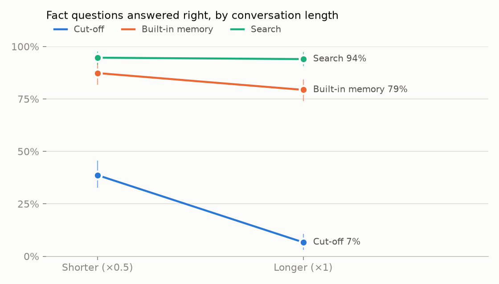
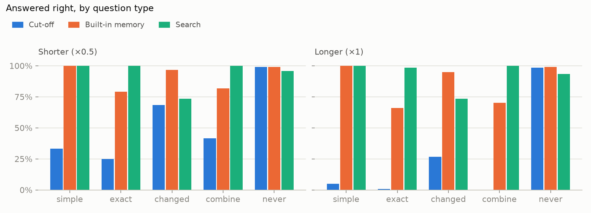
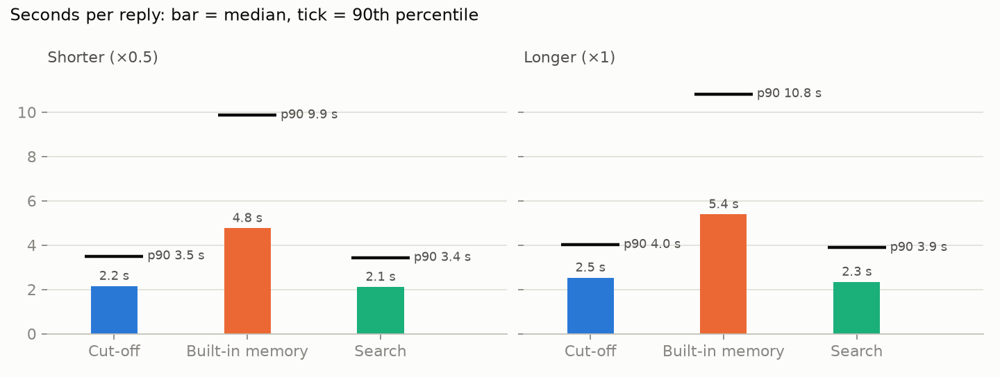
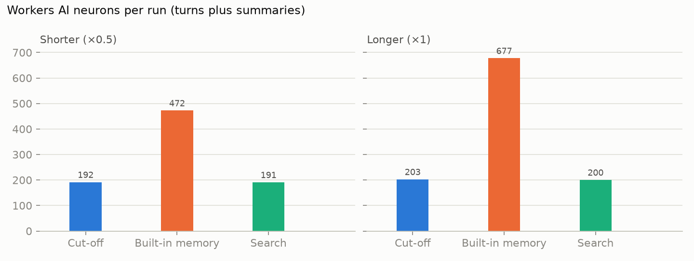

# cf_ai_memory_test

**Which memory design should a chat assistant use: one that keeps only recent messages, one that writes notes and summaries, or one that searches everything it was told? What does each get wrong, and what does it cost?**

This repo builds one chat assistant on Cloudflare's [Agents SDK](https://developers.cloudflare.com/agents/) and [Think](https://developers.cloudflare.com/agents/harnesses/think/), gives it three interchangeable memory designs, and tests them on the same conversations.

**Answer, in one line:** search remembered best (94–95% of facts, and almost no forgetting as conversations got longer) at the same cost and speed as doing nothing. Built-in memory came second (79–87%) at 2.5–3.3× the cost and twice the reply time. Keeping only recent messages forgot most facts (39%, then 7%).

- Live chat: https://cf-ai-memory-test.cf-ai-memory-test.workers.dev
- Side by side, with a fast-forward button and the result charts: https://cf-ai-memory-test.cf-ai-memory-test.workers.dev/demo
- Full statistical report: [analysis/report.md](analysis/report.md)

## The three designs

All three are the same Think agent with the same model (`@cf/qwen/qwen3-30b-a3b-fp8` on Workers AI), the same system prompt and the same tools. Only the memory differs ([src/memory/](src/memory/)).

| Design | What reaches the model on each turn |
|---|---|
| **Cut-off** | The newest messages that fit the budget. Nothing older. |
| **Built-in memory** | Think's own memory: a memory block the model rewrites with the `set_context` tool, plus Sessions compaction, which replaces older messages with a summary. Then the newest messages. |
| **Search** | The newest messages, plus past messages found by full-text (FTS5) search on the words of the user's latest message. |

**Equal context budget.** Every model call from every design gets at most the same 2,000 estimated tokens. The budget counts the system prompt, memory block, summary, search results, history and tool definitions (built-in carries the `set_context` tool definition). It's enforced on every model step, including the step after a tool call, and checked by [test/budget.test.ts](test/budget.test.ts). So a design can only win by choosing *what* to keep, not by sending more.

**Shared system prompt.** It includes one line that affects one question type: *"If the user asks about something they never told you, say so plainly instead of guessing."* It applies to all three designs equally, and it's part of why "never said" questions score high for everyone.

## The test

- **20 test conversations** ([data/conversations/main-*.json](data/conversations/)), written for this experiment. Each plants 7 facts, then asks 7 questions, with small talk in between.
- **Small talk** comes from a pool of 400 exchanges ([data/filler.json](data/filler.json)). It was generated once with the same model and committed, so every run uses the same text. Checks reject small talk that contains personal details or mentions any answer.
- **Five question types:** simple facts; changed facts ("I live in Toronto", later "I moved to Austin"); exact details (numbers, dates); combining two separate messages, where the second refers to the person only indirectly ("my running buddy"); and things never said. "Never said" questions ask about an unmentioned detail of something that *was* mentioned, such as the breed of a puppy whose name was given.
- **Two lengths:** ×0.5 (the main length, 66 small-talk exchanges per conversation) and ×1 (132), to show forgetting.
- **3 repeats** of every conversation per design and length: 20 × 3 × 3 × 2 = **360 runs** and 2,520 graded answers.
- **Every run is a Cloudflare Workflow** ([src/experiment/runner.ts](src/experiment/runner.ts)). It plays the conversation into a fresh agent, inserts small talk without calling the model, grades each answer, and writes everything to D1. A run ID never reaches the labeler, so labelling stays blind to the design.
- **Pilot and test sets are disjoint.** Three pilot conversations (`seed-01`–`03`) set the parameters and appear in no reported result.

**Grading.** A rule-based grader ([src/experiment/grader.ts](src/experiment/grader.ts)) marks each answer right, wrong or unclear. Unclear answers, hedged ones included ("maybe", "I think"), go to manual review. **Where a hand label exists, it overrides the grader in every result**: 112 full-run answers carry one.

## Results

Fact questions exclude "never said" questions. Intervals are 95% and resample whole conversations, because answers within a conversation are correlated. Numbers come from [analysis/report.md](analysis/report.md), except the memory-block hit rate below, which comes from the memory blocks saved after each turn ([results/full-1/](results/full-1/), not in the report).

| Design | Facts right, ×0.5 | Facts right, ×1 | "Never said" right (×0.5 / ×1) | Median reply (p90), ×0.5 | Neurons per run, ×0.5 / ×1 |
|---|---|---|---|---|---|
| **Search** | **94.7%** (91.3–97.7) | **94.0%** (90.7–97.3) | 95.8% / 93.3% | 2.1 s (3.4 s) | 191 / 200 |
| **Built-in memory** | 87.3% (81.7–92.7) | 79.3% (74.0–84.3) | 99.2% / 99.2% | 4.8 s (9.9 s) | 472 / 677 |
| **Cut-off** | 38.7% (32.7–45.7) | 6.7% (3.0–10.7) | 99.2% / 98.3% | 2.2 s (3.5 s) | 192 / 203 |



**Remembering.** Every pair of designs differs at both lengths: Cochran's Q, then exact McNemar with Holm correction, all p ≤ 0.003. At ×1, search beats built-in by 14.7 points (9.0–20.7) and built-in beats cut-off by 72.7 points.

**Forgetting.** Doubling the small talk cost cut-off 32 points (p < 0.001) and built-in 8 points (p = 0.002), and changed nothing for search (0.7 points, p = 0.73).

**Speed.** Built-in replies take about twice as long: 4.8–5.4 s median, about 10 s at p90. Its compaction runs while the user's message is being saved, so the user waits for the summary. Search is marginally faster than cut-off (2.25 s vs 2.37 s median of run medians, p = 0.013).

**Cost.** Search costs the same as cut-off (p = 0.15). Built-in costs 2.5× at ×0.5 and 3.3× at ×1, and **its summaries alone cost more than any other design's whole run** at ×1 (387 of its 677 neurons). The whole 360-run experiment cost 116,128 neurons, **$1.28**.



## What each design gets wrong

| Question type (×1) | Cut-off | Built-in | Search |
|---|---|---|---|
| Simple | 5% | **100%** | **100%** |
| Exact (numbers, dates) | 1% | 66% | **98%** |
| Changed facts | 27% | **95%** | 73% |
| Combining two messages | 0% | 70% | **100%** |
| Never said | 98% | **99%** | 93% |

- **Cut-off** forgets anything older than the budget. Its high "never said" score is the cheapest possible one: it doesn't remember enough to be tempted.
- **Built-in** is the best at **changed facts** (95%), because the model rewrites its memory block when a fact changes. It's weaker at **exact details and combining**, because those depend on the memory block, and the block loses facts:
  - The model rewrites the whole block with `set_context`, and sometimes drops older facts while saving a new one.
  - **14.5% of saved facts were later lost at ×0.5, and 20.5% at ×1.**
  - At ×0.5, when the asked fact was in the block, built-in was right 242 out of 243 times; when it wasn't, 20 out of 57.
- **Search** finds almost anything it was told, but is the weakest at **changed facts** (73%). A keyword lookup returns the old value as readily as the new one. It also invents answers more often on "never said" questions (93–96%).




## How far to trust the grading

The grader was checked against **100 blind hand labels**: answers sampled evenly across design and question type, shown without the design or the grader's verdict. **Agreement was 96/100, Cohen's κ = 0.90.** The grader was not tuned on these 100. Its rules were tuned on 12 earlier pilot answers, which are kept separate and excluded here.

All four disagreements, as they are:

| Question | Design | Grader | Human | Why they differ |
|---|---|---|---|---|
| How long is my whole trip? | Search | wrong | right | "Your trip duration wasn't specified in our conversation" isn't one of the grader's "never told" phrasings |
| Which book are we reading this month? | Built-in | wrong | right | "…after dropping *Middlemarch*": the grader knows "dropped", not "dropping" |
| Which repair shop has my car? | Cut-off | wrong | right | "…sent to Kesler Auto after Duffy's couldn't fix it": that wording isn't recognized as making the old value past |
| Where do I volunteer on weekends? | Cut-off | right | wrong | "If you're referring to the shelter, confirm with the coordinator…" mentions the answer without giving it |

Three of the four have the grader stricter than the human, so the accuracy figures, if anything, slightly understate the designs. Separately, the 12 answers the grader flagged as unclear in the full run were all hand-labelled; those labels count in the results.

## Rejected designs

**Replies with thinking off (the main rejection).** Qwen3 can be told not to "think" before answering (`/no_think`). The pilot tested this on all three designs, and it rejected thinking-off with the following evidence:
- **Faster and cheaper:** median reply 0.45 s against 1.5–3.8 s, and 91–130 neurons per run against 163–420.
- **Search made up answers** to "never said" questions ("Your blood type is O positive", "Your cat's name is Whiskers"); it got 3 of 6 right instead of 5 of 5.
- **Built-in stopped using its memory:** it saved only 14–29% of facts to the memory block, against 79–86% with thinking on.

The full run kept thinking on. (Built-in's *summaries* do run with thinking off, for a different reason; see the limits below.)

Also rejected along the way:
- **Built-in with Think's original memory-block wording.** In the pilot, that wording lost **68%** of saved facts against **30%** for the reworded block ("ALL the facts … every write must include all the facts that still apply"). The reworded block is used in the full run. The original is kept as `BuiltinShippedAgent` so the comparison can be repeated.
- **Search through Sessions' own `search()`.** It treats the whole query as one exact phrase, so a question such as "What's my dog's name?" never matches the message that planted the fact. The search design instead looks up each keyword separately and ranks messages by how many keywords they match.
- **The next design to try: vector search** (Vectorize embeddings instead of FTS5 keywords). It's the obvious answer to search's weakness on changed facts and paraphrases. It wasn't built for this version.

## Limits

- **One model, one budget, synthetic conversations.** The results are for Qwen3-30B with a 2,000-token budget, on 20 fact-dense, hand-written conversations padded with impersonal small talk from the same model. Real chats are messier, and a larger budget would help cut-off.
- **Built-in keeps the opening messages word for word, so old facts never leave its context.** A manual demo test (documented here, not fixed; the designs were not changed):
  - The sequence was "I live in Toronto", small talk, "I just moved to Austin", small talk, then "Where do I live now?".
  - Built-in had Austin in both its memory block and its summary, yet still asked the user to clarify.
  - The cause: Sessions compaction always keeps the first 3 messages verbatim, so "I live in Toronto" stays in context forever.
- **Search answered that same test correctly, but only from recent messages.** Its keyword lookup ("live") retrieved the old Toronto messages. Keyword search has no notion of which value is current; that's the 73% on changed facts.
- **Built-in's summaries run with thinking off.** With thinking on, Qwen3's reasoning used up the 400-token summary allowance, so summaries came back cut off or empty. Compaction then retried on almost every new message: 186 summary calls in one test run, about 24× the other designs' cost. Summaries now use `/no_think`, ask for about 200 words, and a guard waits for 8 new messages after a failed summary before trying again. Even so, built-in's summaries are its biggest cost.
- **"Never said" questions barely separate the designs.** They were made harder after the pilot, where every design scored 100%, but they still score 93–99%. The system-prompt line above helps all designs equally here.
- **Earlier answers stay in history.** Questions come in sequence. Small talk separates them, but search can still retrieve an earlier answer of the assistant's and reuse it.
- **The grader is rule-based.** It agrees with a human 96% of the time (κ 0.90), and the four disagreements are listed above. "Unclear" answers depend on the hedge-word list.
- **The pilot score for built-in (55%) was much lower than the full run (87%).** Same code, same grader:
  - Built-in's accuracy tracks whether the fact is still in its memory block.
  - The three pilot conversations packed more facts per message and lost twice as many facts per run.
  - A sample of 3 conversations gives a wide interval (about 40–69%).
- **Reply times are wall-clock times on shared Workers AI hardware,** and include built-in's in-turn summaries. Medians and p90 are reported rather than means.
- **Fact loss is measured by matching expected answers against the memory-block text,** so a fact reworded beyond recognition counts as lost.
- **3 repeats per cell.** Intervals and tests account for the clustering by conversation, but not for drift in Workers AI over the 17 minutes of the run.

## Engineering notes

- **Doubled streaming output.** `workers-ai-provider` (3.1.14–4.0.0) emits every streamed token twice for models that send both the native and the OpenAI-format fields ([cloudflare/ai#663](https://github.com/cloudflare/ai/pull/663)). That also breaks tool-call arguments. [src/ai/dedupe-binding.ts](src/ai/dedupe-binding.ts) removes the duplicate copy. One extra case, found here: digit tokens arrive with `response` as a JSON *number*, so a text-only fix still doubled numbers ("UA 2291" became "UA 22229911"). An early check run with that bug was discarded.
- **Model choice.** A tool-call smoke test ([scripts/model-smoke.ts](scripts/model-smoke.ts)) chose the model: Qwen3-30B saved 15 of 15 planted facts with `set_context` and was the cheapest candidate. Llama 4 Scout saved 0 of 15: it writes tool calls as plain text.
- **Project cost.** Every script that calls the model logs its cost to [results/model-costs.jsonl](results/model-costs.jsonl). The whole project, including pilots, checks and the full run, cost about **151,000 neurons, $1.66**. The 1,529 neurons for generating the small talk are an estimate, re-measured on 4 topics, because that run didn't record usage.

## Repository

| Path | What it is |
|---|---|
| [src/memory/](src/memory/) | The shared agent ([agent.ts](src/memory/agent.ts)), the equal budget ([tokens.ts](src/memory/tokens.ts)), and the three designs |
| [src/experiment/](src/experiment/) | Conversation format, grader, Workflow runner, pilot analysis helpers |
| [src/client/](src/client/) | Chat page and the side-by-side demo with charts |
| [migrations/](migrations/) | D1 schema for runs, turns, answers and hand labels |
| [data/](data/) | Test conversations (pilot and main) and the small-talk pool |
| [scripts/](scripts/) | Run experiments, check status and cost, export results, hand-labelling round trip, diagnostics |
| [results/](results/) | Exported full-run data, pilot summaries, experiment manifests, cost log |
| [analysis/](analysis/) | Python statistics ([memstats.py](analysis/memstats.py)), report and figures |
| [labels/](labels/) | Hand-labelled answers (CSV) |
| [PROMPTS.md](PROMPTS.md) | Every prompt given to the AI coding tool, with what it did |

## Reproduce

```sh
npm ci && npm test                       # 135 tests (Workers runtime, mock model)
npm run deploy                           # needs `wrangler login` and Workers Paid
npm run db:migrate
npm run experiment -- --id my-run --scale 0.5,1 --repeats 3
npm run experiment:status -- my-run      # progress, results, cost (logged once done)
npm run export:results -- my-run

python3 -m venv analysis/.venv && analysis/.venv/bin/pip install -r analysis/requirements.txt
analysis/.venv/bin/python analysis/run_analysis.py results/my-run
```

The analysis of the committed full run reruns offline with `analysis/.venv/bin/python analysis/run_analysis.py`. CI checks that [analysis/report.md](analysis/report.md) matches the committed data.
